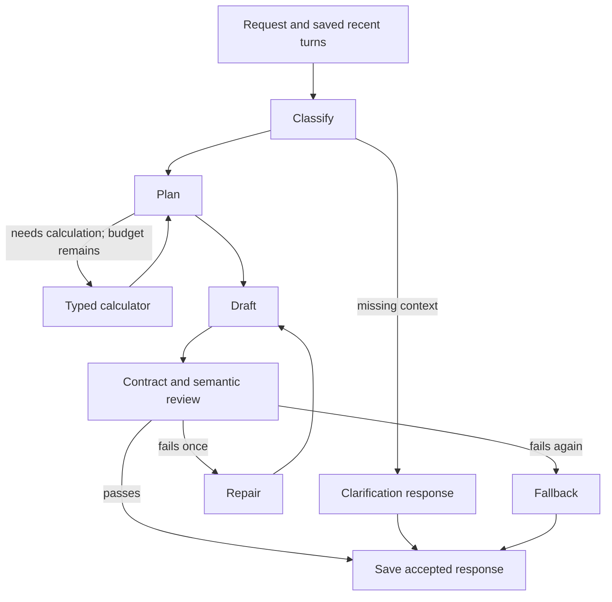

# Backend build and review guide

## Scope

The backend lives in `tarsBe`. It uses Python 3.11+, FastAPI, Pydantic, LangChain's Gemini integration, and a real LangGraph `StateGraph`. The sibling frontend now connects through Vite's `/api/tutor` proxy, replacing its original standalone Gemini experiment path. Run `yarn dev:tutor` from `tarsTutor` to start both services.

## Plan and completed steps

1. **Configuration and contracts:** implemented `.env`, `.env.example`, secret-aware settings, strict input/output models, bounded selected-board context, and the lesson format supported by the current renderer.
2. **Agent workflow:** implemented classification, planning, optional calculator calls, drafting, semantic review, one repair attempt, clarification, and a safe fallback. Intent categories include new topics, follow-ups, clarifications, answers, work review, board references, and off-topic requests.
3. **Tools:** implemented a constrained arithmetic/sigmoid calculator exposed as a LangChain tool. Answer checking runs deterministically against a stored private key when `answer_to_question_id` is present. Selected board text arrives with the request, so reading it requires no separate remote tool.
4. **Session service:** implemented SQLite storage for accepted turns, recent conversation, the active question, and idempotent replay. Stable lesson IDs include the session, so two sessions can use the same turn ID safely. A revision check rejects concurrent session changes rather than overwriting them.
5. **HTTP API:** implemented health/readiness, session creation/readback, and tutor turn endpoints. Added optional shared API token protection, configurable CORS, request size limits, model timeout, overall deadline, and a concurrent generation limit.
6. **Verification and handoff:** implemented offline tests using injected provider responses while executing the actual LangGraph and FastAPI paths. Added pinned direct dependencies, a full installed dependency lock, API examples, and this review guide.

## Workflow



Tool calls use structured `Plan.calculations` decisions and an allowlisted LangChain tool invocation. This is controlled tool dispatch inside LangGraph; it does not grant the model arbitrary Python execution. The graph can run at most two tool rounds with two calculations each, and at most two draft/review attempts. A full path uses at most eight logical model calls, with at most one extra request per call for explicit transient 500/502/503 failures. A normal lesson without tools or repairs uses four calls: classification, planning, drafting, and review. Explicit answer submissions bypass model classification. Model requests time out after 60 seconds and the whole turn has a 180-second deadline by default.

Pydantic validates model decisions and final content. The semantic reviewer checks correctness, teaching criteria, tool evidence, and question keys, but another model's approval is not a mathematical proof. Arithmetic/known-answer checks provide deterministic evidence where available. No hidden model reasoning is returned; `trace` contains only stage names.

## Files

| File | Responsibility |
| --- | --- |
| `app/main.py` | FastAPI routes, request limits, timeouts, response assembly, stable IDs |
| `app/models.py` | Request, intent, plan, tool, draft, review, question, lesson, response contracts |
| `app/graph.py` | LangGraph nodes, routing, bounded tools and repair |
| `app/provider.py` | LangChain Gemini structured-output adapter; replaceable in tests |
| `app/tools.py` | Restricted calculator and authoritative numeric/choice answer checking |
| `app/store.py` | SQLite session/turn persistence, cached responses, optimistic revision checks |
| `app/config.py` | `.env` loading and bounded settings |
| `tests/test_backend.py` | Offline graph/API/tool regression checks |

## Local setup

Run these from `tarsBe` in PowerShell:

```powershell
python -m venv .venv
.\.venv\Scripts\python.exe -m pip install -r requirements-lock.txt
```

`.env` already exists with a blank `GEMINI_API_KEY`. Add your key there; use a `GEMINI_MODEL` available to your account. The default is configurable and does not imply account access. Restart after changing settings. `.gitignore` excludes `.env`, `.venv`, and `data/`. Do not copy the frontend key into browser code.

```powershell
.\.venv\Scripts\python.exe -m uvicorn app.main:app --host 127.0.0.1 --port 8000
```

Swagger UI: http://127.0.0.1:8000/docs. OpenAPI: http://127.0.0.1:8000/openapi.json. Use one worker for local review. SQLite remains on disk at `data/tutor.sqlite3` across restarts. Each connection is closed after use.

`requirements.txt` pins direct runtime packages, `requirements-dev.txt` adds test dependencies, and `requirements-lock.txt` pins the complete tested installation including test packages. The full lock was generated on Python 3.11/Windows; verify installation for a different deployment platform.

## Endpoints

| Method/path | Purpose |
| --- | --- |
| `GET /health` | Process status and whether LLM configuration exists; no provider request |
| `GET /ready` | 503 without a key; configuration readiness only, not proof of model access |
| `POST /api/tutor/sessions` | Create a session, no request body required |
| `GET /api/tutor/sessions/{session_id}` | Last six accepted turns and public active question; never exposes private keys |
| `POST /api/tutor/sessions/{session_id}/turns` | Execute one tutor turn |

If you set `BACKEND_API_TOKEN`, include `X-API-Key` on session and turn requests. This is a shared local service token. User authentication and per-user session ownership are future production work. CORS defaults to no allowed browser origins; PowerShell and Swagger on the same backend still work. Set an explicit origin list only when connecting the frontend.

## Test with example input

Use PowerShell to create a session and send a real request:

```powershell
$baseUrl = 'http://127.0.0.1:8000'
$headers = @{}
# If BACKEND_API_TOKEN is configured:
# $headers = @{ 'X-API-Key' = 'your-local-token' }
$session = Invoke-RestMethod -Method Post -Uri "$baseUrl/api/tutor/sessions" -Headers $headers
$sessionId = $session.session_id
$turn = @{
  turn_id = 'example-1'
  message = 'Why does logistic regression use a sigmoid? What probability does a score of 2 give?'
  board_context = @{
    selected_element_ids = @()
    selected_text = ''
  }
} | ConvertTo-Json -Depth 8
$response = Invoke-RestMethod -Method Post -Uri "$baseUrl/api/tutor/sessions/$sessionId/turns" -Headers $headers -ContentType 'application/json' -Body $turn
$response | ConvertTo-Json -Depth 12
```

Expect a response with `status`, `intent`, `reply`, optional `lesson`, optional public `question`, optional `feedback`, `next_action`, `model`, and a stage-name `trace`. The probability should be around 0.8808. A tool-assisted path usually includes `classify, plan, tools, plan, draft, validate`, but routing depends on model decisions; it may also include repair. Response text varies. No frontend board is changed by this request.

The nested lesson has the existing client's camel-case `lessonId` and `turnId`, and stable step/block IDs. Only `text` and `formula` blocks are generated. The outer API uses snake_case. A future client adapter can pass `response.lesson` through its runtime validator and renderer.

Send a follow-up using the same session:

```powershell
$followup = @{ turn_id = 'example-2'; message = 'Why is a probability not a guarantee?' } | ConvertTo-Json
Invoke-RestMethod -Method Post -Uri "$baseUrl/api/tutor/sessions/$sessionId/turns" -Headers $headers -ContentType 'application/json' -Body $followup
```

If a question was returned, submit its ID and your answer. Numeric answers use a plain number in the units requested. Choice answers use the exact choice text or its zero-based index:

```powershell
if ($response.question) {
  $answer = @{ turn_id = 'answer-1'; message = '4'; answer_to_question_id = $response.question.id } | ConvertTo-Json
  Invoke-RestMethod -Method Post -Uri "$baseUrl/api/tutor/sessions/$sessionId/turns" -Headers $headers -ContentType 'application/json' -Body $answer
}
```

Replace `4` with an answer to the actual returned question. Question creation is optional, so ask explicitly for a numeric practice question if needed. The active question survives follow-up turns until a newer question replaces it. An unknown/replaced question ID is rejected. A nonnumeric answer to a numeric question produces `feedback.correct = null`, asking for the expected answer format.

For text work review, send `action: "review_work"` and `board_context.selected_text`, for example `2x + 3 = 7; 2x = 10; x = 5`. The tutor should identify the subtraction error. No selected text produces a clarification. Images, PDFs, and raw canvas strokes are not accepted by this version.

Repeating the identical request with the same session/turn ID returns the saved response without calling the LLM again. An identical in-flight request joins the original task, including after a browser cancellation. A different in-flight turn for the same conversation gets 409. Use a new turn ID for a new student turn. Optimistic SQLite revisions also prevent lost history across processes. In-flight coordination is local to one server process; use one worker until distributed coordination is added.

## Automated verification

```powershell
.\.venv\Scripts\python.exe -m pytest -q
.\.venv\Scripts\python.exe -m pip check
```

Tests run without an API key and exercise real API routes and graph transitions with an injected provider. They cover calculator execution and bounds, context across turns, persistence across app restarts, idempotency/conflicts, clarification, repair/fallback, tool-round limits, private keys, answer grading, auth, input limits, missing credentials, provider failures, and timeouts. An additional compatibility check constructs Gemini's structured-output runnables without sending a paid request.

Verification result on this build: **25 tests passed**, including malformed structured-output repair, simultaneous session-update conflicts, same-request in-flight deduplication, provider timeout mapping, and bounded transient retry/recovery. `pip check` reported no broken requirements.

Live Gemini was tested with the key in this backend's `.env` and `gemini-3.5-flash-lite`. Calculator-backed teaching, follow-up context, question creation, grading, cached replay, and private-key filtering passed. See [test-report.md](test-report.md) for timing, fixes, and the limits of this smoke test. These checks cover a small sample and do not establish general teaching quality.

Common failures: 422 = invalid request/question, 404 = unknown session, 409 = turn-ID or session-revision conflict, 429 = local concurrency capacity, 503 = missing key or temporary provider unavailability after retry, 504 = model or overall deadline, 502 = other provider or model-decision failure. Provider error details are not sent to clients because they can contain private content. An invalid final draft gets one repair; a second failure returns `status: fallback` with no lesson. Failed HTTP turns are not saved, so the same ID can be retried. SDK retries remain disabled; application code retries only explicit upstream 500/502/503 once after 750ms, within the same overall deadline. Successful generations, quota errors, and timeouts are not automatically retried.

Run the opt-in live smoke test with your configured key:

```powershell
.\.venv\Scripts\python.exe scripts/smoke_live.py
```

This executes actual Gemini calls through FastAPI's in-process HTTP test client, using an isolated temporary database. It checks a calculator-backed lesson, cached replay without extra model calls, a contextual follow-up, creation of a numeric question, grading, and private answer-key filtering. It does not require a separate Uvicorn process. It prints stage timing and responses while redacting the key. Live calls incur provider usage and can fail under provider load.

## Next work after review

- Verify live model behavior with your key and build a teaching-quality evaluation set before enabling this for students.
- Frontend connection is implemented: session restoration, selected board text, bounded waiting/cancellation, exact-request retry, and reply/feedback/practice UI. Test from the frontend URL printed by `yarn dev:tutor`.
- Add image/handwriting review, document ingestion/retrieval, and sourced web research as explicit capabilities with their own contracts. No MCP access or runtime skills file is needed for the current local tools.
- Add a rolling session summary for long lessons. Current memory is the most recent six accepted turns and the active question; there is no long-term learner profile yet.
- For public hosting, add user authentication/session ownership, per-user quotas, migration/backup policy, telemetry for cost and latency, and distributed in-flight request coordination. Move to a managed database if multiple workers/hosts are needed.
- Add transport cancellation/disconnect handling and streaming when connecting the client. Current requests have a bounded deadline; disconnecting a caller may still allow the turn to finish and be cached. In-progress graph state is not checkpointed across a process crash; accepted turns are durable and can be replayed.

## References checked for this implementation

- [FastAPI settings](https://fastapi.tiangolo.com/advanced/settings/)
- [LangChain Gemini structured output](https://docs.langchain.com/oss/python/integrations/chat/google_generative_ai)
- [LangGraph graph API](https://docs.langchain.com/oss/python/langgraph/graph-api)
